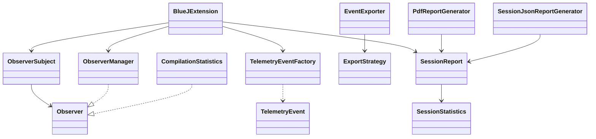

# Design and Architecture

## Overall class diagram

## Pattern 1 — Observer

**Implementation:** `observer/Observer.java`, `ObserverSubject.java`,
`ObserverManager.java`, and `statistics/CompilationStatistics.java`.

`BlueJExtension` publishes each event through `ObserverSubject`. The subject
notifies its observers. `ObserverManager` stores the event history and
`CompilationStatistics` independently calculates compilation metrics.

**Benefit:** telemetry collection is separated from the consumers of telemetry.
New observers can be added without changing the BlueJ listener callbacks.

## Pattern 2 — Factory Method

**Implementation:** `factory/TelemetryEventFactory.java` and the concrete
`CompilationEventFactory`, `ClassEventFactory`, `EditorEventFactory`,
`ExecutionEventFactory`, and `ProjectEventFactory`.

Each concrete factory creates a particular `TelemetryEvent` subtype. The
BlueJ integration delegates event construction to these factories rather than
building every event inline.

**Benefit:** event construction and validation are centralized and the callback
code is easier to maintain.

## Pattern 3 — Strategy

**Implementation:** `strategy/ExportStrategy.java`, `EventExporter.java`,
`JsonExportStrategy.java`, `CsvExportStrategy.java`, and `TextExportStrategy.java`.

`EventExporter` uses the `ExportStrategy` interface. The active format can be
changed at runtime without changing the exporter.

**Benefit:** new export formats can be added without rewriting the event
collection code.

## SOLID principles

- **Single Responsibility:** BlueJ callbacks, event models, observer storage,
  statistics, serialization and PDF generation are in separate classes.
- **Open/Closed:** new formats implement `ExportStrategy`; the exporter does
  not need a new conditional branch for each format.
- **Liskov Substitution:** each concrete exporter can be used wherever an
  `ExportStrategy` is expected.
- **Interface Segregation:** observers depend on the small `Observer` callback
  contract instead of a large telemetry-management interface.
- **Dependency Inversion:** `EventExporter` depends on the `ExportStrategy`
  abstraction rather than directly depending on JSON, CSV or text exporters.

## Important implementation references

| Concern | Main implementation |
|---|---|
| BlueJ event listeners | `bluej/BlueJExtension.java` |
| Edit/idle estimates | `editor/EditorActivityTracker.java` |
| Event data model | `events/` |
| Event creation | `factory/` |
| Observer distribution | `observer/` |
| Live compilation statistics | `statistics/CompilationStatistics.java` |
| Interchangeable exports | `strategy/` |
| Session calculations | `report/SessionStatistics.java` |
| JSON report | `report/SessionJsonReportGenerator.java` |
| PDF report | `report/PdfReportGenerator.java` |
